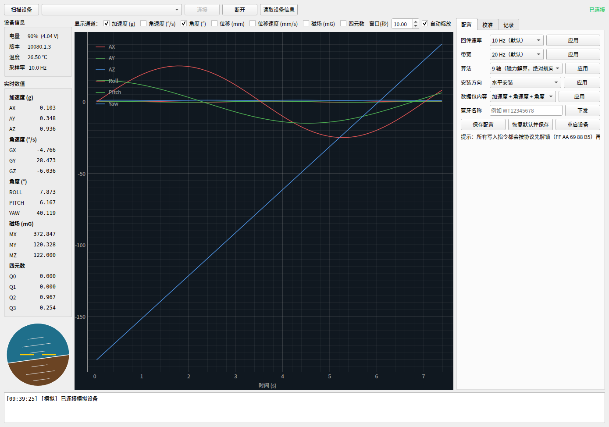

# WT9011DCL-BT50 Linux 上位机

维特智能（WitMotion）**WT9011DCL-BT50** 蓝牙 5.0 姿态传感器的 Linux 端上位机替代品。

厂商只提供 Windows 上位机（`WitMotion(V2026.9.30.0).zip`，.NET Framework 4.6.2 + WPF），
这个仓库用 **Python + bleak(BlueZ) + PySide6** 重新实现其常用功能，直接跑在 Linux 上。

```
┌───────────────┐   BLE 5.0 (GATT)   ┌──────────────────────────────┐
│ WT9011DCL-BT50│ ─────────────────► │ wt9011 (本仓库)              │
│ 0x55 0x61 数据 │  FFE5/FFE4/FFE9    │  protocol → client → cli/gui │
└───────────────┘                    └──────────────────────────────┘
```

## 功能对照（Windows 上位机 → 本项目）

| Windows 上位机 | 本项目 | 说明 |
|---|---|---|
| 蓝牙搜索/连接 | ✅ GUI「扫描设备 / 连接」，CLI `scan` | 只认 WT/BWT 开头或带 FFE5 服务的设备 |
| 实时数据（加速度/角速度/角度） | ✅ | 与官方同样换算：16g / 2000°/s / 180° 满量程 |
| 波形曲线 | ✅ pyqtgraph 多通道 + 时间窗 | 加速度/角速度/角度/位移/速度/磁场/四元数 |
| 姿态 3D/仪表 | ✅ 2D 姿态仪（roll/pitch） | Windows 版用 HelixToolkit 3D，本项目先用仪表盘 |
| 磁场、四元数、温度、电量 | ✅ | 磁场同时给出原始 mG 与上位机口径值（raw/120） |
| 回传速率 / 带宽 / 算法 / 安装方向 / 输出内容 | ✅ | 全部按协议走「解锁 → 写寄存器 → 保存」 |
| 加速度校准、磁场校准向导 | ✅ | 磁场校准：进入 → 三轴各转 3 圈 → 完成并保存 |
| Z 轴角度归零、角度参考 | ✅ | 归零需先切六轴算法（界面会提示） |
| 保存配置 / 恢复默认 / 重启 | ✅ | `FF AA 00 00 00` / `01` / `FF` |
| 数据记录 CSV | ✅ | GUI 记录页 / CLI `stream --csv` |
| 改蓝牙名称 | ✅ | `WT` + 名称 + `\r\n`，需重启生效 |
| 3D 模型、卫星地图、振动分析、Word 报告导出 | ❌ | Windows 版特有（HelixToolkit / WebView2 / GemBox），未移植 |

## 安装

系统要求：Linux + BlueZ（`bluetoothd` 运行中，有 BLE 适配器，普通用户即可，无需 root）。

```bash
cd WT9011DCL-BT50-Linux

# 方式一：直接在当前 Python 环境安装依赖
pip install -r requirements.txt          # bleak + PySide6 + pyqtgraph

# 方式二：虚拟环境（推荐）
python3 -m venv .venv && . .venv/bin/activate
pip install -r requirements.txt

# 可选：装成本包，拿到 wt9011 / wt9011-gui 两个命令
pip install -e .
```

## 使用

### 图形界面

```bash
./run.sh                # 等于 python3 -m wt9011.gui
./run.sh --mock         # 没有硬件时用模拟数据演示界面
./run.sh --addr AA:BB:CC:DD:EE:FF   # 直接连指定 MAC
```

界面：左上扫描/连接，左侧实时数值 + 姿态仪，中间多通道曲线，
右侧「配置 / 校准 / 记录」三个标签页，底部日志。

### 命令行

```bash
./run.sh cli scan                        # 扫描附近的维特设备
./run.sh cli info                        # 电量 / 版本 / 温度 / 磁场
./run.sh cli stream                      # 终端实时打印（默认 5Hz 刷新）
./run.sh cli stream --csv run.csv --seconds 30
./run.sh cli stream --rate 0x07          # 先设 20Hz 再采
./run.sh cli read RATE                   # 读寄存器（返回从该地址起的 8 个）
./run.sh cli write RATE 0x08 --verify    # 写寄存器并回读（自动解锁+保存）
./run.sh cli calib acc                   # 加速度校准（先水平静止）
./run.sh cli calib mag-start             # 进入磁场校准 → 三轴各转 3 圈
./run.sh cli calib mag-stop              # 完成并保存
./run.sh cli calib yaw-zero              # Z 轴角度归零
./run.sh cli mode 1                      # 输出位移+位移速度+角度
./run.sh cli send "FF AA 27 3A 00"       # 直接下发十六进制指令
./run.sh cli stream --mock               # 无硬件演示
```

## 安装到 Ubuntu 应用菜单（可选）

```bash
./install-desktop.sh              # 安装/更新
./install-desktop.sh --uninstall   # 卸载
```

安装后（全部在用户目录，不需要 sudo）：

| 位置 | 内容 |
|---|---|
| `~/.local/share/applications/wt9011-bt50.desktop` | 应用菜单条目「WT9011 上位机」 |
| `~/.local/share/icons/hicolor/.../apps/wt9011-bt50.{svg,png}` | 应用图标 |
| `~/.local/bin/wt9011` | 命令行入口（scan/stream/read/write/calib…） |
| `~/.local/bin/wt9011-gui` | 图形界面入口 |

脚本会自动挑一个装了 `bleak + PySide6 + pyqtgraph` 的解释器并写进启动器，
所以在最小 PATH 的应用菜单环境里也能正常启动。

## 常见问题（BLE/BlueZ 相关）

| 现象 | 原因与处理 |
|---|---|
| `org.bluez.Error.InProgress` / `Operation already in progress` | BlueZ 里还挂着一次半连接（在 GNOME 蓝牙设置里点过这个设备最常见）。客户端会**自动**执行 `bluetoothctl disconnect <地址>` 清掉再重试；也可手动清：`bluetoothctl disconnect EE:AA:BB:...`，实在不行 `sudo systemctl restart bluetooth`。 |
| 第一次能连，之后 `scan` 扫不到设备 | 维特 BLE 模块连过一次后常常停止广播。本程序默认**不扫描、直接按地址连**（`BleakClient(address)`），所以照常能连；只要别把地址忘了（界面会自动记住上次设备）。 |
| 手机 App / Windows 上位机 / GNOME 蓝牙面板连过之后连不上 | BLE 只允许一个中心设备。先在对方断开（GNOME：蓝牙设置里那个设备点“断开”），再用本程序连。 |
| 电量显示 0% / 0.00 V | WT901BLE67 这类模块不通过 BLE 上报电池（寄存器 `0x64` 返回 0），属正常；带电池的型号会显示。 |
| `Failed to connect`、`le-connection-abort` | 距离/干扰问题：靠近一点（RSSI > −80 更稳），避开 USB3 硬盘坞等 2.4G 干扰源；程序会自动重试 3 次并自动重连。 |


| 项 | 值 |
|---|---|
| 服务 / 通知 / 写入 | `0000ffe5-…` / `0000ffe4-…` / `0000ffe9-…` |
| 数据包 | `0x55 0x61` + 9×int16 小端（加速度 XYZ、角速度 XYZ、角度 XYZ），共 20 字节 |
| 寄存器回传 | `0x55 0x71` + 起始寄存器(2B) + 8×int16（16B） |
| 读寄存器 | `FF AA 27 <reg> 00` |
| 写寄存器 | `FF AA <reg> <valL> <valH>` |
| 解锁 | `FF AA 69 88 B5`（10 秒内有效） |
| 保存 | `FF AA 00 00 00`（`01` 恢复默认、`FF` 重启） |
| 换算 | 加速度 `/32768*16g`；角速度 `/32768*2000°/s`；角度 `/32768*180°`；温度 `/100 ℃`；四元数 `/32768`；磁场原始值 mG，上位机口径 = `raw/120` |

协议原始文档（语雀镜像，已清洗成可读 Markdown）见 `docs/`。

## 代码结构

```
wt9011/
├── protocol.py   协议常量、寄存器表、数据包解析、指令组包、换算（无第三方依赖，可单独测）
├── client.py     bleak 客户端：扫描/连接/通知解析/读寄存器/写寄存器/校准/配置
├── sim.py        模拟设备：没有硬件时驱动 GUI 与 CLI（--mock）
├── cli.py        命令行入口
└── gui.py        PySide6 图形界面（BLE 跑在独立 QThread 的 asyncio 事件循环里）
tests/
└── test_protocol.py  协议解析/组包单测（用文档里的字节样例做断言）
tools/
└── smoke_gui.py      界面冒烟测试（offscreen + 模拟数据，可出截图）
docs/            厂商协议文档镜像（清洗版）+ 界面截图
```

## 验证情况



```bash
python3 -m unittest discover -s tests -v          # 17 项协议单测
python3 tools/smoke_gui.py --screenshot /tmp/gui.png   # 界面冒烟（offscreen，模拟数据，含关闭流程）
./run.sh cli stream --mock --seconds 3            # 命令行 + 模拟数据
./run.sh --mock                                   # 界面 + 模拟数据（有显示器时）
```

实测结果：

- ✅ 协议单测 17/17 通过（含文档样例：磁场帧 `55713A00680169007A00` → 360/105/122；版本号样例 → `10080.1.3`；各条指令字节与文档一致）
- ✅ `BleakScanner` 在本机可直接扫描（无需 root），能列出周围 BLE 设备
- ✅ 界面在模拟数据下运行正常：数值刷新、曲线、姿态仪、CSV 记录（10 Hz → 15 行/1.5 s）、窗口关闭 0.3 s 内正常退出、无异常
- ⏳ **真实硬件连通性待现场验证**：传感器开机 → `./run.sh cli scan`，应出现 `WT…` 设备

## 已知限制

1. **只支持蓝牙（BLE）连接方式**。Windows 上位机还能走 USB 转串口，本项目的串口版没做
   （协议相同，用 `pyserial` 接 `/dev/ttyUSB*` 也能很快加，如需要可扩展）。
2. 磁场/四元数需要**主动读寄存器**（模块不会主动推），界面按 1Hz 轮询；要更高频率可改 `gui.py` 里的 `aux_timer`。
3. 位移/位移速度依赖模块自身的 0x96 输出模式，精度由模块算法决定。
4. 未实现 Windows 版独有的 3D 模型、地图、振动分析、Word 报告导出。
5. 蓝牙连接独占：手机 App 或 Windows 上位机连着时，Linux 这边连不上，需先断开对端。

## 与 Windows 上位机的关系

Windows 版是 .NET Framework 4.6.2 + WPF（HelixToolkit 3D、WebView2、GemBox.Document），
其中蓝牙后端直接调用 WinRT `Windows.Devices.Bluetooth`，**在 Linux/Wine 下无法工作**，
因此选择了「按协议重写」而不是「移植」。如果要复刻界面层，可用 ILSpy 反编译
（程序未混淆且带 PDB，能得到接近源码的 C#），再把 XAML 迁移到 Avalonia；本仓库走的是更省力的协议重写路线。
